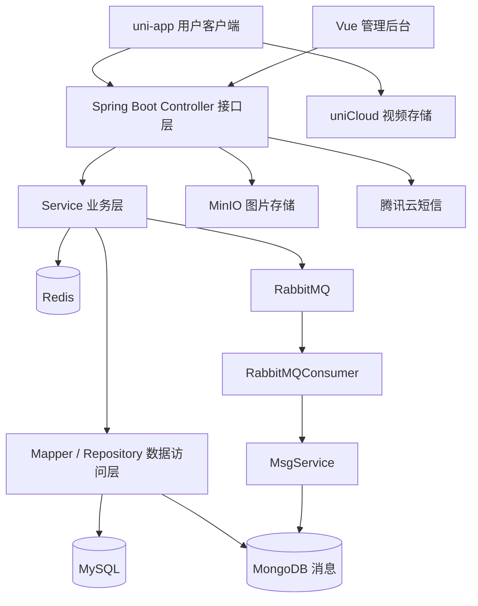

# ShayuVideo API · 鲨鱼视频后端

ShayuVideo 是一个仿抖音的短视频项目，围绕视频发布与浏览、评论点赞、关注关系、消息通知、内容审核和举报申诉提供业务功能。本仓库是 Java 后端，为 uni-app 用户客户端和 Vue 管理后台提供 HTTP API。

**本 README 的工程结构、环境配置和启动命令均针对后端项目。** 管理后台与 APP 分别维护在独立仓库中，前端页面及运行方式请查看对应仓库。

后端采用 **Maven 父子聚合工程**，各业务模块在同一个 Spring Boot 应用内协作。当前没有实际微服务拆分，也未使用 Nginx 负载均衡。UserCF 推荐代码已编写，**尚未投入实际使用**。

## 目录

- [项目组成与技术栈](#项目组成与技术栈)
- [架构与工程结构](#架构与工程结构)
- [系统功能框架](#系统功能框架)
- [核心业务流程](#核心业务流程)
- [数据存储](#数据存储)
- [快速开始](#快速开始)
- [本地配置](#本地配置)
- [构建与启动（PowerShell）](#构建与启动powershell)
- [接口文档与联调](#接口文档与联调)
- [代码生成器](#代码生成器)
- [重置凭据后](#重置凭据后)
- [常见问题](#常见问题)
- [功能边界与验证情况](#功能边界与验证情况)
- [相关文档与协作](#相关文档与协作)
- [许可证](#许可证)

## 项目组成与技术栈

| 工程与仓库 | 定位 | 主要技术 |
| --- | --- | --- |
| [ShayuVideo_api](https://github.com/tangmyy/ShayuVideo_api)（本仓库） | Java 后端，提供业务接口与后台服务 | Java 8、Spring Boot 2.5.4、Maven |
| [ShayuVideo_admin](https://github.com/tangmyy/ShayuVideo_admin) | Web 管理后台，独立工程 | Vue 3、Vite、Element Plus、Pinia、Axios、ECharts |
| [ShayuVideo_APP](https://github.com/tangmyy/ShayuVideo_APP) | APP 用户客户端，独立工程；本地目录为 `ShayuVideoAPP` | uni-app、Vue 2、nvue |

uni-app 的框架支持能力不等同于所有平台都已完成适配和上线，各目标平台需分别验证。

| 后端组件 | 用途 |
| --- | --- |
| MyBatis、通用 Mapper、PageHelper | 数据访问与分页查询 |
| MySQL | 核心关系型业务数据 |
| Redis | 会话、验证码、互动关系及计数等缓存 |
| MongoDB、Spring Data MongoDB | 消息通知的保存与查询 |
| RabbitMQ、Spring AMQP | 异步通知处理 |
| MinIO | 头像、背景图等图片对象存储 |
| 腾讯云短信 SDK | 登录验证码短信 |
| Nacos | 工程中已有配置中心及注册发现集成；不代表微服务拆分 |
| Knife4j、Swagger | 接口文档 |

**视频文件由客户端通过 uniCloud 上传**，Java 后端保存视频地址及相关业务数据；不能将视频上传通道描述为 MinIO。

## 架构与工程结构



Controller、Service、Mapper 是同一后端应用内的分层，不是独立微服务，也没有单独的 API 网关。

```text
ShayuVideo_api/
├── shayu-api/          # 启动入口、Controller、拦截器、配置、消息消费者
├── shayu-service/      # 业务服务接口与实现
├── shayu-mapper/       # MyBatis Mapper、SQL XML、MongoDB Repository
├── shayu-model/        # POJO、BO、VO、MO 等数据模型
├── shayu-common/       # 工具、枚举、统一响应、异常处理
├── mybatis-generator/  # 模型与 Mapper 代码生成器
├── .env.example        # 可提交的环境变量模板
├── .env                # 本地真实配置，不提交
├── with-env.ps1        # PowerShell 环境变量加载与命令执行脚本
└── pom.xml             # 父工程、模块聚合及依赖版本管理
```

启动入口：`shayu-api/src/main/java/com/zx/cuicuisha/Application.java`。

## 系统功能框架

### 用户端业务

```text
用户端业务
├── 认证与会话（PassportController）
│   ├── 获取短信验证码、IP 频率限制
│   ├── 验证码登录 / 注册、退出登录
│   └── Redis 保存验证码和会话
├── 用户信息（UserInfoController）
│   ├── 查询个人信息、作者公开信息
│   ├── 修改昵称、简介、生日、性别和地区
│   └── 头像与背景图上传
├── 视频（VlogController）
│   ├── 发布、修改、详情、删除
│   ├── 首页、关注、朋友视频流与关键词搜索
│   ├── 个人公开 / 私密视频列表
│   └── 点赞 / 取消点赞、公开 / 私密设置
├── 评论（CommentController）
│   ├── 发表评论、回复、删除、分页列表
│   └── 点赞 / 取消点赞评论
├── 关注关系（FansController）
│   ├── 关注 / 取消关注、查询是否关注
│   └── 粉丝列表、关注列表、互相关注标记
├── 消息（MsgController）
│   ├── 分页查询、删除消息
│   └── 关注、点赞、评论、回复及系统通知
├── 举报（ReportController）
│   └── 视频 / 评论举报与记录查询
└── 申诉（AppealController）
    └── 视频 / 评论申诉与记录查询
```

验证码接口设置了同一 IP 60 秒内的请求限制，验证码缓存时间为 2 分钟。具体参数以 Controller 与拦截器实现为准，不能将这一限制描述为全站接口限流。

### 管理端业务

```text
管理端业务（AdminController，统一前缀 /admin）
├── 管理员登录、退出
├── 用户管理：列表、资料与头像维护、添加、删除 / 恢复、封禁 / 解封
├── 视频管理：列表、信息维护、删除 / 恢复、审核与排序设置
├── 评论管理：列表、修改、删除 / 恢复
├── 关注关系：列表查询
├── 消息管理：列表、修改、删除、发送系统消息及公告
├── 举报管理：列表、处理、修改、重置、统计
├── 申诉管理：列表、处理、修改、重置、统计
└── 数据统计：用户、视频、评论、点赞、举报和申诉等
```

### UserCF 代码状态

仓库中包含 `RecommendationController`、`UserCFServiceImpl` 和推荐 SQL，但尚未投入实际使用。当前首页调用 `/vlog/indexList`，首页“推荐”栏目名称不代表已启用 UserCF。

已有算法代码从点赞（1 分）和评论（2 分）构建用户与视频评分矩阵，同一用户对同一视频取最高分；通过余弦相似度寻找相似用户，预测并排序候选视频。没有行为或相似用户时返回空列表。评分来源不是完整观看历史，不能宣称已经过滤所有看过的视频。

## 核心业务流程

### 视频上传、发布与审核

```text
客户端选择或拍摄视频
    → uniCloud.uploadFile 上传文件
    → 获取视频地址并编辑标题、封面等信息
    → /vlog/publish 保存视频记录、创建待审核记录
    → 管理员审核或封禁 / 解封
```

审核状态：`0` 为审核中，`1` 为通过，`2` 为拒绝 / 封禁。封禁时保存原始私密状态并设为私密，解封时恢复原始状态。待审核视频是否可见由具体列表和详情接口的过滤条件决定，不将现有流程描述为已实现“审核通过后才公开”。

### 消息创建与删除

```text
关注 / 点赞 / 评论 / 系统通知等业务
    → RabbitMQ exchange_msg（Topic）
    → sys.msg.* 路由绑定到 queue_sys_msg
    → RabbitMQConsumer 识别消息类型
    → MsgService.createMsg / createAdminMsg
    → MongoDB 保存通知
```

取消关注、取消点赞或删除评论等操作可调用 `deleteMsgByCondition`，按发送者、接收者、类型及消息内容条件删除关联消息。通知异步消费不等同于已实现 WebSocket 推送或即时聊天；这里不承诺投递时延和一致性指标。

### 举报与申诉

```text
用户提交视频 / 评论举报 → 保存举报记录 → 管理员处理 → 通知举报人
被处理用户提交申诉 → 管理员处理申诉 → 通知申诉人
```

## 数据存储

| 存储 | 数据 |
| --- | --- |
| MySQL | `users`、`admin_users`、`vlog`、`vlog_audit`、`comment`、`fans`、`my_liked_vlog`、`report`、`appeal` 共 9 张业务表 |
| MongoDB | 消息对象，主要包含发送者、接收者、消息类型、内容和创建时间 |
| Redis | 用户 / 管理员会话、验证码、互动关系、计数及推荐代码中的缓存 |
| MinIO | 图片文件 |
| uniCloud | 客户端上传的视频文件，不是本后端内置存储服务 |

## 快速开始

1. 安装 JDK 8 和 Maven，准备 MySQL、Redis、MongoDB、RabbitMQ、MinIO、Nacos 及腾讯云短信所需配置。中间件版本需与实际部署环境核对，本文不填未经验证的版本号。
2. 初始化 MySQL：完整项目资料目录中有 `shayuvideo.sql`，但当前后端仓库内没有 SQL 文件。独立克隆本仓库时，需另行取得结构脚本；导入前先检查并移除真实用户资料和可用账号数据。
3. 创建数据库应用账号、MongoDB 用户及认证库、RabbitMQ virtual host 和权限、MinIO 桶及访问凭据。确保应用到各服务的网络可达。
4. 按下面的步骤创建并填写 `.env`，构建和启动后端。
5. 通过接口文档检查接口，再联调用户端与管理端。

腾讯云短信除了密钥，还需要自己的短信应用 ID、签名和模板 ID。目前这些业务参数仍写在 `shayu-common/src/main/java/com/zx/cuicuisha/utils/SMSUtils.java` 中，开发者需要按自己的已审核短信资源调整；仅填写密钥不保证短信可用。Nacos 外部配置也要单独检查，避免其中的旧配置覆盖本地设置。

## 本地配置

在后端根目录执行：

```powershell
Copy-Item .env.example .env
```

填写 `.env`。该文件被 Git 忽略，禁止提交；`.env.example` 是不含真实凭据的公开模板。已有本地 `.env` 时不要覆盖。

`.env` 使用每行 `KEY=VALUE` 格式，不加引号、不写行尾注释、不进行转义，密码中的 `$`、`#`、`=` 按原样填写。变量由 `with-env.ps1` 按文本读取，不会作为 PowerShell 代码执行。MongoDB URI 中的用户名、密码如果包含 URI 特殊字符，需要进行百分号编码。

| 变量 | 说明 |
| --- | --- |
| `SPRING_PROFILES_ACTIVE` | `dev` 或 `prod`，决定使用哪组配置 |
| `DEV_*` / `PROD_*` | 对应开发 / 生产环境；只需准备要运行环境的一组完整配置 |
| `*_SERVER_PORT` | 后端 HTTP 端口 |
| `*_DB_URL` / `*_DB_USERNAME` / `*_DB_PASSWORD` | MySQL JDBC 地址、账号和密码 |
| `*_REDIS_HOST` / `*_REDIS_PORT` / `*_REDIS_DATABASE` / `*_REDIS_PASSWORD` | Redis 地址、端口、库编号和密码 |
| `*_MONGODB_URI` / `*_MONGODB_DATABASE` | MongoDB 连接串（包含认证信息）和数据库名 |
| `*_RABBITMQ_HOST` / `*_RABBITMQ_PORT` / `*_RABBITMQ_USERNAME` / `*_RABBITMQ_PASSWORD` / `*_RABBITMQ_VIRTUAL_HOST` | RabbitMQ 连接配置 |
| `*_MINIO_ENDPOINT` / `*_MINIO_FILE_HOST` / `*_MINIO_BUCKET` | MinIO 接口地址、文件访问地址和桶名 |
| `*_MINIO_ACCESS_KEY` / `*_MINIO_SECRET_KEY` | MinIO 访问凭据 |
| `NACOS_CONFIG_ADDR` | Nacos 配置中心地址，bootstrap 阶段使用 |
| `*_NACOS_DISCOVERY_ADDR` | 对应环境的 Nacos 注册地址 |
| `TENCENT_SECRET_ID` / `TENCENT_SECRET_KEY` | 腾讯云短信访问密钥 |
| `GENERATOR_DB_URL` / `GENERATOR_DB_USERNAME` / `GENERATOR_DB_PASSWORD` | 代码生成器使用的独立数据库连接配置 |

表中 `*` 代表 `DEV` 或 `PROD`。完整变量清单见 `.env.example`。数据库需先初始化，MongoDB 用户认证库、RabbitMQ virtual host 权限、MinIO 桶及腾讯云短信服务需按实际环境准备；本次没有将这些外部依赖改成可选服务。

## 构建与启动（PowerShell）

```powershell
# 在后端根目录构建可执行 JAR
mvn -pl shayu-api -am package -DskipTests

# 加载 .env 后启动；当前项目版本为 v2.5.0
.\with-env.ps1 java -jar .\shayu-api\target\shayu-api_v2.5.0.jar
```

脚本会覆盖子进程中的同名变量，结束后恢复调用环境。脚本不输出配置值。

Spring Boot 不会自动读取此项目的 `.env`。直接从 IDEA 启动时，在运行配置中设置相同环境变量；不要把带真实值的运行配置共享到 Git。Nacos 的凭据和外部配置内容也需要单独管理，本地脱敏不会清理配置中心。

## 接口文档与联调

应用成功启动后，可尝试访问 `http://localhost:<实际端口>/doc.html`（Knife4j）或 `/v2/api-docs`（Swagger JSON）。项目已有相关配置，访问结果仍需在实际运行环境验证；不要将文档页面可访问当作所有业务服务均正常。

| 接口前缀 | 用途 |
| --- | --- |
| `/passport/*` | 验证码、登录和退出 |
| `/userInfo/*` | 用户信息与图片 |
| `/vlog/*` | 视频列表、详情、管理和点赞 |
| `/comment/*` | 评论与回复 |
| `/fans/*` | 关注与粉丝 |
| `/msg/*` | 消息通知 |
| `/report/*`、`/appeal/*` | 举报与申诉 |
| `/admin/*` | 管理员认证、内容管理及数据统计 |
| `/recommendation/*` | UserCF 相关代码接口，尚未投入实际使用 |

请求参数、方法及响应结构以 Controller 和生成的接口文档为准。用户会话相关代码使用 `headerUserId`、`headerUserToken`；当前 `InterceptorConfig` 只将用户 Token 拦截器注册到修改资料和图片的两个路径，不代表所有业务接口已统一鉴权。对外部署前需逐项检查身份与操作权限。

联调时，移动端在其 `App.vue` 中设置后端地址；管理后台核对 Vite `/admin` 代理目标，正式部署另行配置实际接口访问路径。手机或模拟器中的 `localhost` 不一定指向运行后端的电脑。

## 代码生成器

`generatorConfig.xml` 通过 MyBatis Generator 的配置变量机制引用 `GENERATOR_DB_*`，`GeneratorDisplay` 已将进程环境变量传入解析器。

从 IDEA 执行生成器时，设置这三个环境变量，并将工作目录设为后端根目录；也可在当前 PowerShell 中执行 `. .\with-env.ps1` 加载变量后，从该终端启动生成器所需的 Java 命令。生成器会写入模型和 Mapper 文件，不要将生成操作作为普通启动检查。

## 重置凭据后

先在数据库、中间件或云平台轮换凭据，再修改本地 `.env` 对应值并重启应用。开发、生产和生成器若复用同一账号，需同步更新所有引用；腾讯云替换成功后禁用旧密钥。

提交前确认 `git check-ignore .env` 命中规则，且 `git ls-files .env` 无输出。公开 YAML、properties、XML 中只保留变量引用。旧提交中已有的凭据不会因本次修改而消失，仍需轮换及另行处理历史。

## 常见问题

| 现象 | 排查方向 |
| --- | --- |
| 提示无法解析 `${...}` | 是否通过脚本加载 `.env`，变量名是否完整，运行环境是否与 `DEV_*` / `PROD_*` 对应 |
| 修改 `.env` 后没有生效 | 重启应用；IDEA 直接启动不自动读取 `.env`；检查 Nacos 外部配置和其他启动参数 |
| MySQL 连接失败 | 数据库是否已创建、账号权限、JDBC 地址、驱动及数据库版本兼容性 |
| MongoDB 认证失败 | URI 中的 `authSource`、账号所属认证库和特殊字符编码 |
| RabbitMQ 启动或消费失败 | virtual host、账号权限、网络连接和队列声明日志 |
| MinIO 图片上传或访问失败 | 桶是否存在、访问权限、endpoint 和 fileHost 是否分别适用于服务端及客户端 |
| 验证码未收到 | 密钥权限、应用 ID、签名、模板、服务额度及腾讯云返回错误 |
| 手机上访问不到后端 | 使用电脑可访问的局域网地址，检查端口、防火墙及网络连通性 |

不要在 issue、截图或日志附件中附上完整 `.env`、密码、密钥或含认证信息的 MongoDB URI。

## 功能边界与验证情况

- 当前为单个后端应用的 Maven 多模块工程；没有实际微服务拆分、独立网关和 Nginx 负载均衡。
- UserCF 尚未投入实际使用；附近视频流在客户端功能资料中标为待开放。
- 源码使用 Redis 缓存、PageHelper 分页和 RabbitMQ 异步通知，但本文不宣称已通过高并发、CDN、缓存预热或性能压测验证，也不将“定时入库”作为已确认能力。
- 当前材料没有证明全量接口已统一鉴权、各目标平台已完成适配，或已实现自动内容审核、人脸登录等能力。
- 此前配置改造已通过后端打包、生成器编译、环境变量加载及模板完整性检查。构建使用了 `-DskipTests`，不代表通过业务测试；本次 README 合并未启动外部服务或执行端到端验收。
- 测试目录不代表完整测试覆盖。独立部署前，建议验证登录、视频发布与播放、评论点赞、关注、消息消费、举报申诉和管理操作等关键链路。

## 相关文档与协作

- [消息类型模板文档](./消息类型模板文档.md)：消息类型与内容结构。
- [UserCF 实现思路](./UserCF实现思路.md)：推荐算法代码设计资料。
- [UserCF 使用说明](./UserCF使用说明.md)：推荐代码接口资料；实际投入状态以本 README 为准。

原《系统功能框架图.md》已整合至本 README，后续维护统一修改这里。

提交问题时，请说明运行环境、复现步骤、预期与实际结果，并提供脱敏日志。修改配置变量时，同步更新 `.env.example`、相关 YAML / properties / XML 和本 README，避免模板与运行代码不一致。

后续适合补充的仓库资料包括：脱敏的数据库结构脚本、实际界面截图、验证过的中间件版本和关键链路测试记录。

## 许可证

本项目采用 [MIT License](./LICENSE)。
